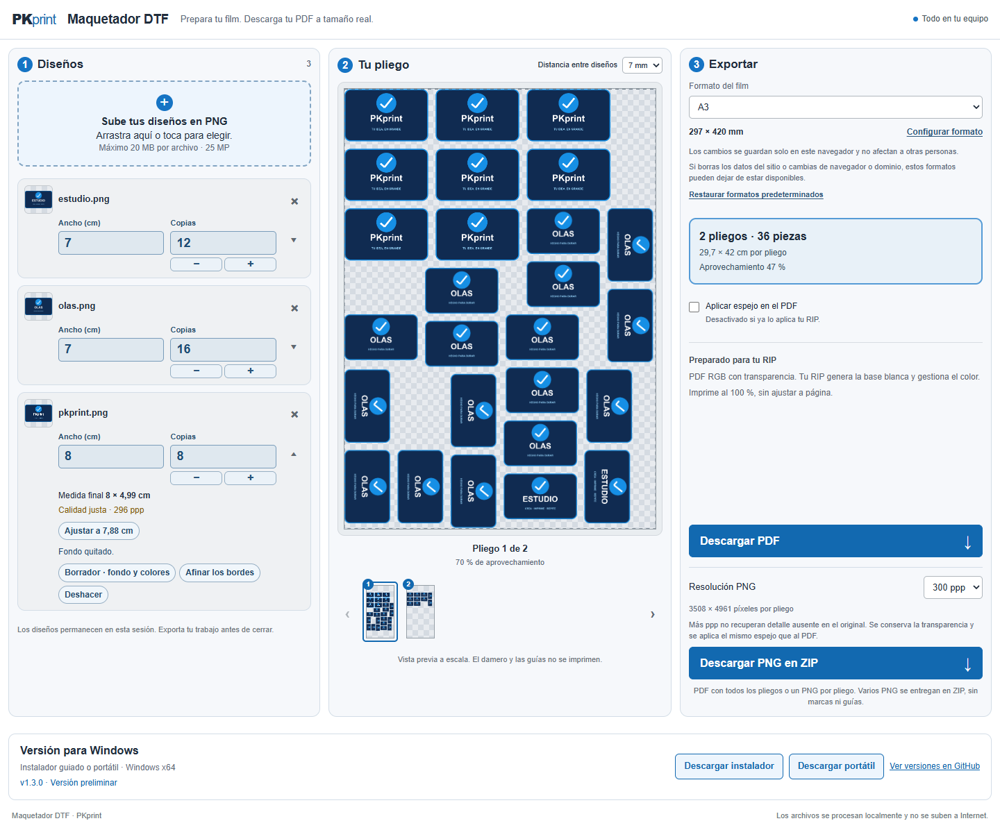
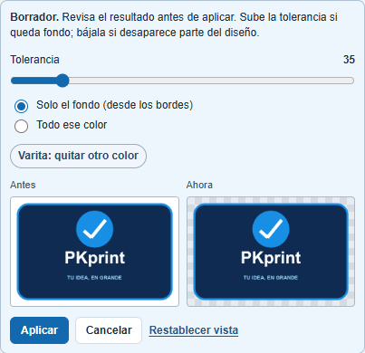

# Maquetador DTF · PKprint

**Prepara tus diseños, aprovecha el film y exporta para imprimir.**

Carga tus imágenes, indica sus medidas y cuántas copias necesitas. Maquetador DTF las distribuye en los pliegos y prepara un PDF o imágenes PNG con fondo transparente para llevar a tu RIP.

**[Abrir versión web](https://dtf.wcard.es)** · **[Descargar para Windows](https://github.com/jared-esparza/MaquetadorDTF/releases)**

Sin registro · Diseños procesados en tu equipo · Web y Windows

*Un mismo espacio para preparar los diseños, revisar el montaje y exportar. Captura de una versión anterior; los controles actuales se describen debajo.*

## Qué puedes hacer

- **Dar a cada diseño su tamaño y sus copias.** Trabaja con PNG, JPG/JPEG, WebP estático o páginas PDF, también en cargas mixtas. Edita el ancho o el alto en centímetros: la otra medida se ajusta conservando la proporción.
- **Quitar fondos y colores.** Revisa el antes y el después, ajusta la tolerancia o usa la varita para eliminar otro color.
- **Distribuir los diseños automáticamente.** El montaje puede girarlos para aprovechar el espacio y crea varios pliegos cuando hace falta.
- **Adaptar el film a tu trabajo.** Incluye Film 55 × 100 cm, A3 y A4; puedes personalizar formatos y márgenes. La separación se elige entre 3 y 7 mm, con **7 mm por defecto**.
- **Exportar como prefieras.** PDF individual por pliego (la opción habitual) o un único PDF; con varios pliegos puedes descargar un ZIP de PDFs. También PNG transparente a **150, 300 o 600 ppp** —300 por defecto—; varios pliegos se entregan en un ZIP.
- **Nombrar el trabajo antes de descargar.** El nombre editable empieza con fecha y hora local y se comparte entre PNG, PDF, ZIP y los pliegos numerados que contiene.
- **Elegir el presupuesto de imágenes.** 60 MP por defecto, ampliables a 120 o 240 MP, con consumo visible y preferencia guardada. Los niveles mayores requieren más memoria; las copias del montaje no multiplican el contador.
- **Aplicar espejo cuando lo necesites.** La opción se aplica tanto al PDF como al PNG.

*Comprueba el resultado antes de aplicar la eliminación del fondo.*

## Empieza en tres pasos

1. **Carga tus diseños.** Arrastra una imagen o PDF, selecciona las páginas que quieras y, para PDF, elige 300 o 600 ppp. Después indica el ancho o el alto y las copias. Si lo necesitas, elimina el fondo.
2. **Prepara el pliego.** Elige el formato, los márgenes y la separación. Revisa la distribución y el número de pliegos.
3. **Exporta para imprimir.** Revisa el nombre del trabajo y descarga el PDF o el PNG/ZIP. Si aparece un aviso de baja resolución, revísalo antes de continuar: aumentar los ppp de salida no recupera detalle del original.

## Elige web o Windows

| | Web | Windows instalada | Windows portátil |
|---|---|---|---|
| Cómo empezar | [Abrir en el navegador](https://dtf.wcard.es) | Descargar el Setup y seguir el asistente en español | Descargar el Portable y abrir el EXE |
| Instalación | No requiere | Por usuario, con acceso directo | Sin instalación; usa una carpeta con permiso de escritura |
| Sin conexión | Se necesita conexión para abrir la web; las exportaciones se procesan localmente | Editor y exportaciones sin Internet | Editor y exportaciones sin Internet |
| Formatos y preferencias | En ese navegador y dominio | En el perfil de Windows | En `MaquetadorDTF-datos`, junto al EXE |
| Actualizaciones | Disponible al volver a cargar la web tras una publicación | Manual, aviso antes de descargar o descarga automática | Comprobación y descarga asistida; reemplazas el EXE |

Los ejecutables incluyen lo necesario: **no necesitas instalar Node.js**. Son para **Windows 10/11 de 64 bits**. En [Releases](https://github.com/jared-esparza/MaquetadorDTF/releases) encontrarás el instalador y el portátil, incluidas las versiones preliminares. La distribución actual no está firmada; Windows puede mostrar avisos o bloquearla según sus políticas.

Desde **1.3.0**, la instalada avisa antes de descargar por defecto. Incluso con descarga automática, tú decides cuándo instalar y reiniciar; se bloquea mientras haya trabajo sin exportar u operaciones en curso. Se incluyen las versiones preliminares. Si vienes de una versión anterior, instala 1.3.0 o posterior manualmente una vez. En portátil, conserva la carpeta `MaquetadorDTF-datos` al cambiar el EXE o moverlo a otro PC.

Consulta la [guía de Windows](docs/USO-WINDOWS.md) para instalar, exportar y actualizar.

## Antes de imprimir

- Imprime a **100 % / Tamaño real**, sin ajustar a página. En PNG, respeta su tamaño físico y resolución; extrae primero los archivos si descargaste un ZIP.
- Coordina el **espejo** con tu RIP para no aplicarlo dos veces. Por defecto está desactivado en el maquetador.
- La salida conserva transparencia, medidas, márgenes y giros. El damero y las guías de la vista previa no se imprimen.
- El archivo es RGB: tu **RIP debe gestionar el color y generar la base blanca**. La aplicación no incluye conversión CMYK, perfiles ICC de impresora ni canales de tinta blanca, y no sustituye al RIP.
- Antes de producir, abre la **calibración desde Ayuda** en la aplicación de escritorio: imprime el cuadrado de 100 × 100 mm a tamaño real y comprueba medidas y orientación en tu equipo.

## Tus diseños y tus formatos

Los diseños se procesan localmente y **no se suben a un servidor**. No necesitas cuenta. La web consulta GitHub para ofrecer las descargas de Windows y la aplicación de escritorio puede consultar las actualizaciones según tu configuración.

En la web, cambiar un formato **solo afecta a tu navegador**, nunca a otras personas. Puedes restaurar los formatos predeterminados conservando los personalizados. Borrar los datos del sitio o cambiar de navegador o dominio puede hacer que esas preferencias dejen de estar disponibles. La web y el escritorio mantienen configuraciones separadas.

**Los diseños duran durante la sesión: exporta antes de cerrar o recargar.** No se guardan proyectos editables; el PDF, el PNG y el ZIP son archivos de salida para impresión.

## Documentación y ayuda

- [Uso en Windows: instalación, portátil, exportación y actualizaciones](docs/USO-WINDOWS.md)
- [Desarrollo, requisitos, límites y pruebas](docs/DESARROLLO.md)
- [Estado del proyecto y contexto para continuar el desarrollo](docs/CONTEXTO.md)
- [Historial de cambios](CHANGELOG.md)
- [Proceso de publicación de versiones](docs/PUBLICACION.md) · [Despliegue web](docs/DEPLOY-WEB.md)
- [Comunicar un problema o proponer una mejora](https://github.com/jared-esparza/MaquetadorDTF/issues)

Al comunicar un problema, indica si usas web o escritorio, la versión, los pasos para reproducirlo y el resultado esperado. Comparte únicamente diseños que puedas hacer públicos.

## Licencia

La licencia de reutilización del código propio está pendiente; el proyecto no declara una licencia MIT ni GPL. Las dependencias mantienen sus respectivas licencias: consulta los [avisos de terceros](build/THIRD_PARTY_NOTICES.txt). Los paquetes de Windows incluyen también los avisos de Electron y Chromium.
